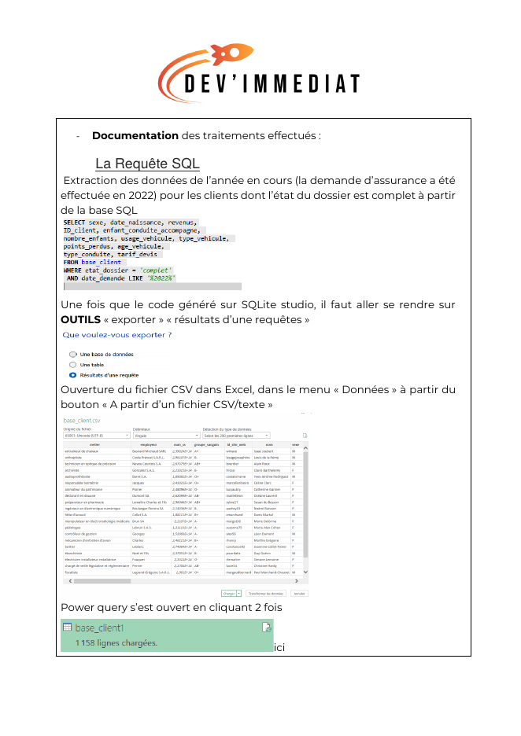
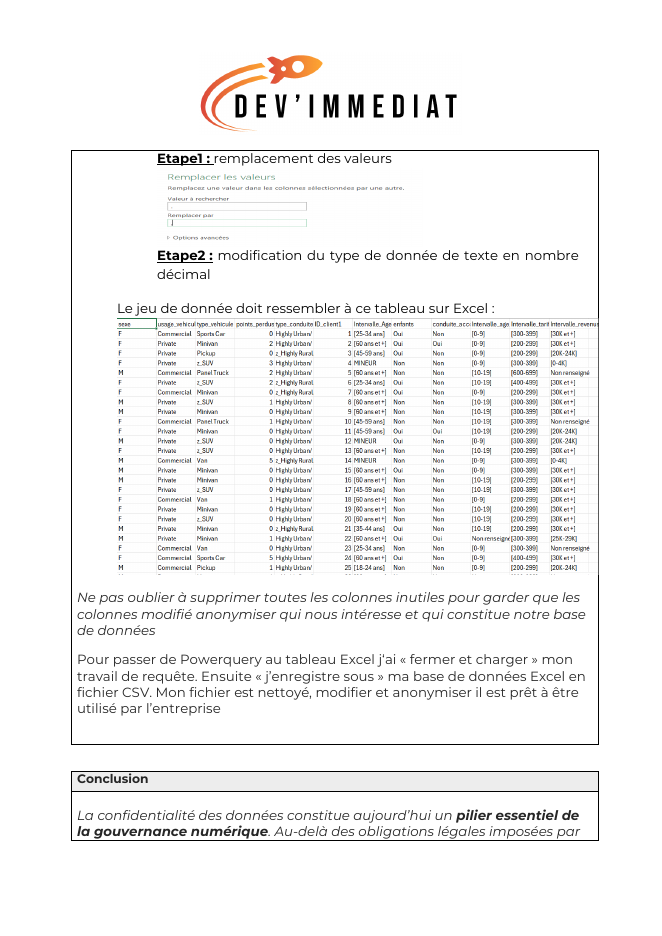

# 🔐 Collecter des données en respectant le RGPD

*Projet 4 de la formation **Business Intelligence Analyst** – OpenClassrooms · Projet validé*

## 🎯 Contexte et objectif

L'entreprise **Dev'Immédiat** a été sanctionnée par la CNIL pour sa gestion des données clients dans son CRM.

Ma mission : **mettre les données en conformité avec le RGPD** tout en gardant leur intérêt pour l'analyse :
- extraire les données utiles avec SQL,
- **anonymiser** les informations personnelles,
- rédiger des **recommandations** pour garantir le respect du RGPD à l'avenir.

## 🛠️ Outils et compétences

- **SQL (SQLite Studio)** : extraction ciblée des dossiers complets de l'année
- **Excel et Power Query** : nettoyage, suppression des colonnes inutiles, création de colonnes personnalisées
- **Anonymisation** : suppression des identifiants directs (nom, e-mail, téléphone), regroupement en **tranches** (âge, revenus, tarif, âge du véhicule), identifiants remplacés par des codes
- **RGPD** : principes de transparence, minimisation, sécurité et traçabilité ; registre des traitements

## 🔎 Démarche

1. **Analyser les données** avec le dictionnaire des données pour repérer les colonnes personnelles ou sensibles
2. **Extraire** les données nécessaires avec une requête SQL, puis les exporter en CSV
3. **Anonymiser** dans Power Query : par exemple, la date de naissance devient une tranche d'âge (« 25-34 ans »)
4. **Livrer un fichier CSV propre et anonymisé**, prêt à être analysé
5. **Rédiger des recommandations** pour une conformité durable

## 📊 Aperçu

**Extraction des données avec SQL**

**Jeu de données final, anonymisé**

## 💡 Mes 4 recommandations

1. **Transparence** : informer chaque client de l'usage de ses données et de ses droits
2. **Minimisation** : ne garder que les données strictement nécessaires, avec une revue régulière des champs collectés
3. **Sécurité et anonymisation** : analyses uniquement sur données anonymisées, fichiers chiffrés, accès limités
4. **Traçabilité** : consigner chaque traitement dans un registre et documenter les procédures

## 📁 Fichiers du projet

| Fichier | Contenu |
|---|---|
| [rapport_traitement_donnees.pdf](rapport_traitement_donnees.pdf) | Le rapport complet de traitement des données |
| [recommandations_rgpd.pdf](recommandations_rgpd.pdf) | Les recommandations RGPD |
| [donnees_anonymisees.csv](donnees_anonymisees.csv) | Le fichier final anonymisé (données fictives du projet) |

---
👩‍💼 **Manal Salhi** – Business Analyst / Data Analyst · [LinkedIn](https://www.linkedin.com/in/manal-salhi-030a692b5/)
